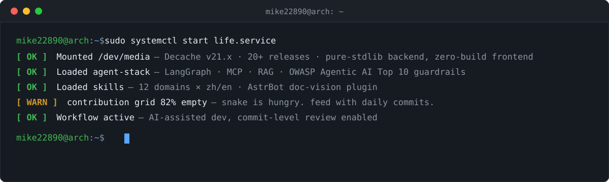

### AI 应用开发 · Agent 方向

`2027 届 · 可实习/到岗`

    -FCC624?logo=linux&logoColor=black) 

<picture>
  <source media="(prefers-color-scheme: dark)" srcset="https://raw.githubusercontent.com/mike22890/mike22890/output/github-contribution-grid-snake-dark.svg" />
  <source media="(prefers-color-scheme: light)" srcset="https://raw.githubusercontent.com/mike22890/mike22890/output/github-contribution-grid-snake.svg" />
  
</picture>

*Open to AI application engineering roles · 项目详情见各仓库*
